# 图片原文件与来源

[返回首页](../README.md) · [图片与字体授权范围](../THIRD_PARTY_NOTICES.md)

本项目实际用到的图片都随仓库提供。下载整个仓库即可取得赛道原图、缩略图、透明队标、榜单背景和演示成图；无需访问制作者的本地磁盘。

## 22张赛道

| 缩略预览，点击查看原图 | 地图 | 下载与实际出处 |
|---|---|---|
| <a href="maps/originals/夜游潇湘.png">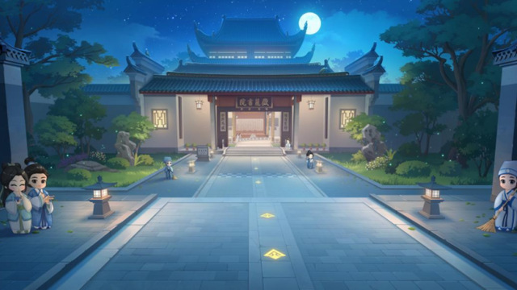</a> | **夜游潇湘** | [原图](maps/originals/夜游潇湘.png) · [来源页面](https://news.17173.com/content/09152025/170622165.shtml) |
|  | **苏格兰场** | [原图](maps/originals/苏格兰场.png) · [来源页面](https://wiki.biligame.com/qqspeed/%E8%8B%8F%E6%A0%BC%E5%85%B0%E5%9C%BA) |
| <a href="maps/originals/流觞曲水.jpg">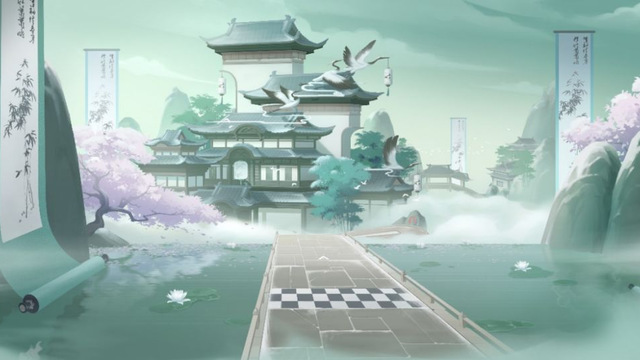</a> | **流觞曲水** | [原图](maps/originals/流觞曲水.jpg) · [来源页面](https://www.taptap.cn/moment/485586502978374892?group_id=41517) |
| <a href="maps/originals/千户苗寨.png">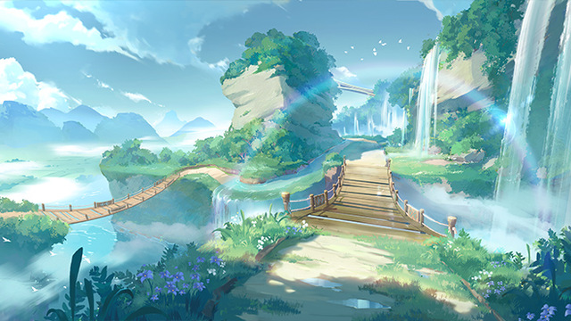</a> | **千户苗寨** | [原图](maps/originals/千户苗寨.png) · [来源页面](https://wiki.biligame.com/qqspeed/%E5%8D%83%E6%88%B7%E8%8B%97%E5%AF%A8) |
|  | **兰舟听雪** | [原图](maps/originals/兰舟听雪.jpg) · [来源页面](https://news.17173.com/content/02102026/112043353.shtml) |
| <a href="maps/originals/疾风机场.jpg">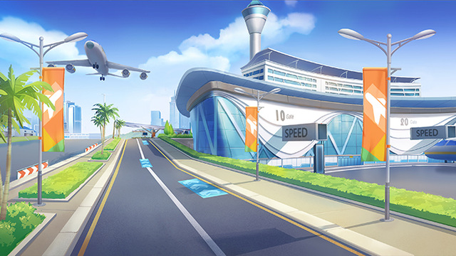</a> | **疾风机场** | [原图](maps/originals/疾风机场.jpg) · [来源页面](https://wiki.biligame.com/qqspeed/%E7%96%BE%E9%A3%8E%E6%9C%BA%E5%9C%BA) |
| <a href="maps/originals/老街工地.png">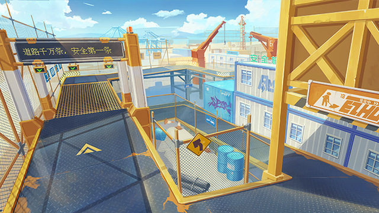</a> | **老街工地** | [原图](maps/originals/老街工地.png) · [来源页面](https://wiki.biligame.com/qqspeed/%E8%80%81%E8%A1%97%E5%B7%A5%E5%9C%B0) |
| <a href="maps/originals/踏雪寻春.jpg">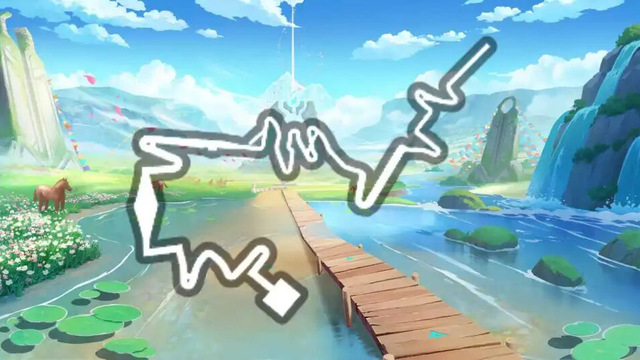</a> | **踏雪寻春** | [原图](maps/originals/踏雪寻春.jpg) · [来源页面](https://news.17173.com/content/02102026/112043353.shtml) |
|  | **端午竞渡** | [原图](maps/originals/端午竞渡.png) · [来源页面](https://wiki.biligame.com/qqspeed/%E7%AB%AF%E5%8D%88%E7%AB%9E%E6%B8%A1) |
|  | **亚特兰蒂斯** | [原图](maps/originals/亚特兰蒂斯.jpg) · [来源页面](https://wiki.biligame.com/qqspeed/%E4%BA%9A%E7%89%B9%E5%85%B0%E8%92%82%E6%96%AF) |
|  | **山海画境** | [原图](maps/originals/山海画境.jpg) · [来源页面](https://weibo.com/ttarticle/p/show?id=2309405123198470717780) |
| <a href="maps/originals/特洛伊环城.png">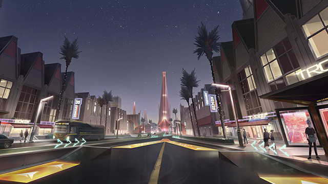</a> | **特洛伊环城** | [原图](maps/originals/特洛伊环城.png) · [来源页面](https://wiki.biligame.com/qqspeed/%E7%89%B9%E6%B4%9B%E4%BC%8A%E7%8E%AF%E5%9F%8E) |
| <a href="maps/originals/11城.png">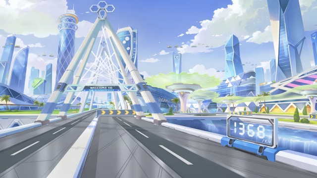</a> | **11城** | [原图](maps/originals/11城.png) · [来源页面](https://wiki.biligame.com/qqspeed/11%E5%9F%8E) |
| <a href="maps/originals/雾山五行.png">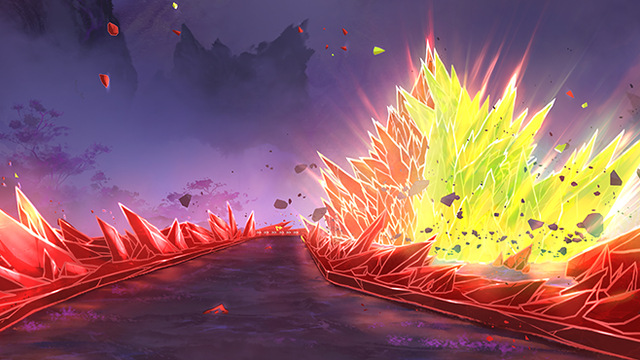</a> | **雾山五行** | [原图](maps/originals/雾山五行.png) · [来源页面](https://wiki.biligame.com/qqspeed/%E9%9B%BE%E5%B1%B1%E4%BA%94%E8%A1%8C) |
|  | **伊甸掠影** | [原图](maps/originals/伊甸掠影.png) · [来源页面](https://wiki.biligame.com/qqspeed/%E4%BC%8A%E7%94%B8%E6%8E%A0%E5%BD%B1) |
|  | **阿尔法总部** | [原图](maps/originals/阿尔法总部.jpg) · [来源页面](https://news.17173.com/z/qqfcsy/content/01112021/183411662.shtml) |
| <a href="maps/originals/天宫寻梦.png">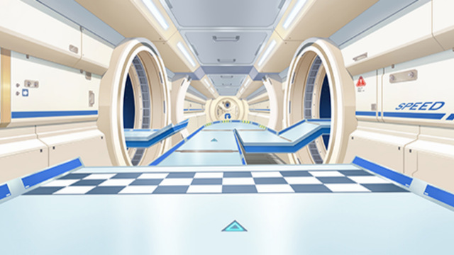</a> | **天宫寻梦** | [原图](maps/originals/天宫寻梦.png) · [来源页面](https://wiki.biligame.com/qqspeed/%E5%A4%A9%E5%AE%AB%E5%AF%BB%E6%A2%A6) |
| <a href="maps/originals/泰坦之巅.png">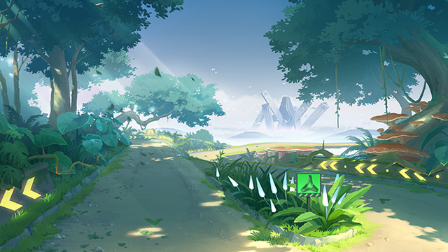</a> | **泰坦之巅** | [原图](maps/originals/泰坦之巅.png) · [来源页面](https://wiki.biligame.com/qqspeed/%E6%B3%B0%E5%9D%A6%E4%B9%8B%E5%B7%85) |
| <a href="maps/originals/决战！雪山之巅.jpg">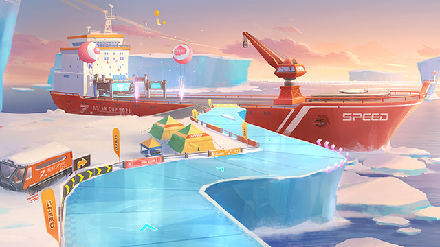</a> | **决战！雪山之巅** | [原图](maps/originals/决战！雪山之巅.jpg) · [来源页面](https://wiki.biligame.com/qqspeed/%E5%86%B3%E6%88%98%EF%BC%81%E9%9B%AA%E5%B1%B1%E4%B9%8B%E5%B7%85) |
|  | **秋名山** | [原图](maps/originals/秋名山.jpg) · [来源页面](https://wiki.biligame.com/qqspeed/%E7%A7%8B%E5%90%8D%E5%B1%B1) |
| <a href="maps/originals/云涌天门.png">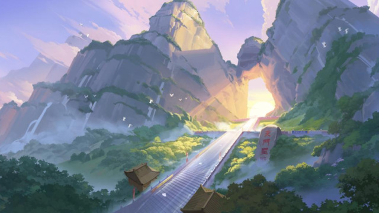</a> | **云涌天门** | [原图](maps/originals/云涌天门.png) · [来源页面](https://news.17173.com/content/09152025/170622165.shtml) |
|  | **心渊** | [原图](maps/originals/心渊.jpg) · [来源页面](https://news.17173.com/content/11202025/164453142.shtml) |

索引：[catalog.json](maps/catalog.json)。原图保留在[originals](maps/originals/)，缩略图保留在[maps](maps/)。

## 六枚透明队标

| 预览 | 名称与原文件 |
|---|---|
|  | [波喵 PNG](logos/bomiao-logo.png) |
|  | [寒岛 PNG](logos/handao-logo.png) |
|  | [不知豆队 PNG](logos/buzhidou-logo.png) |
|  | [虾头路障 PNG](logos/xiatou-luzhang-logo.png) |
|  | [宇宙胖猴 PNG](logos/yuzhou-panghou-logo.png) |
|  | [爱康tv PNG](logos/aikang-tv-logo.png) |

## 榜单背景

这是不含数据文字的背景原文件，榜单文字与分数由程序另行排版。

## 成图与校验值

6场战报和累计均分榜的PNG、JPG均在[演示图片目录](../docs/images/)，[成图展厅](../docs/GALLERY.md)中直接展示。图片来源见[sources.json](sources.json)；全部图片的文件大小和SHA-256见[manifest.json](manifest.json)。
