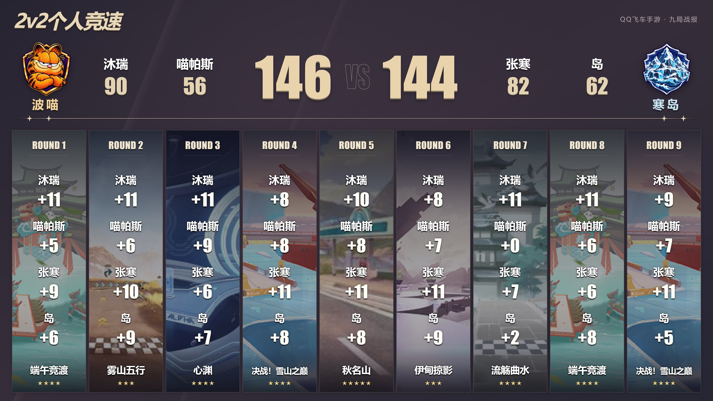
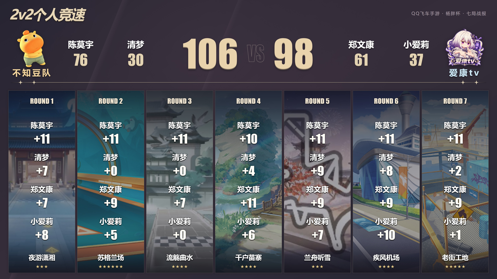
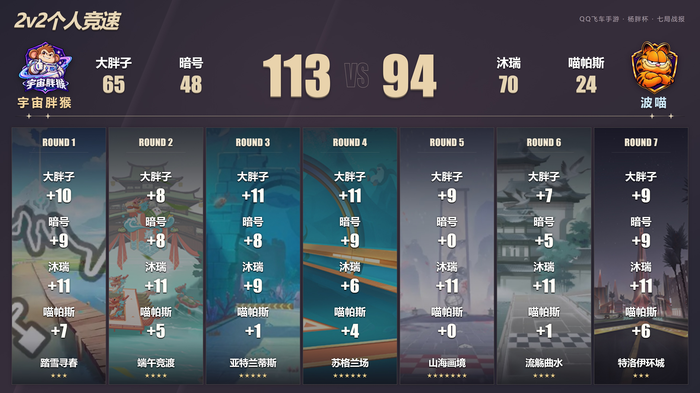
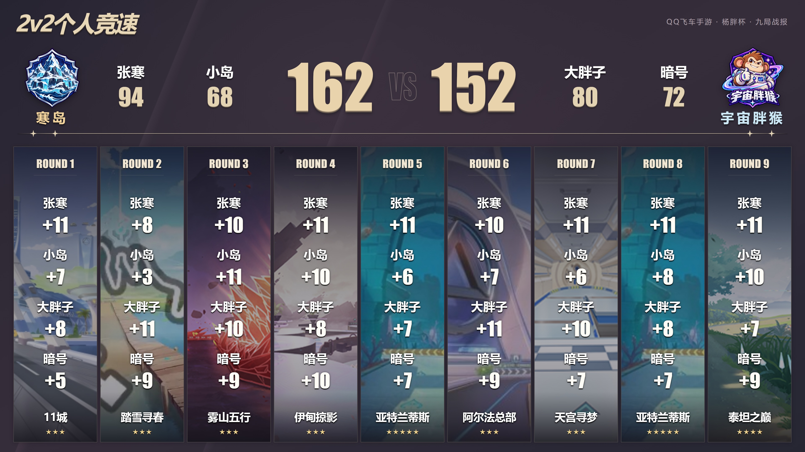
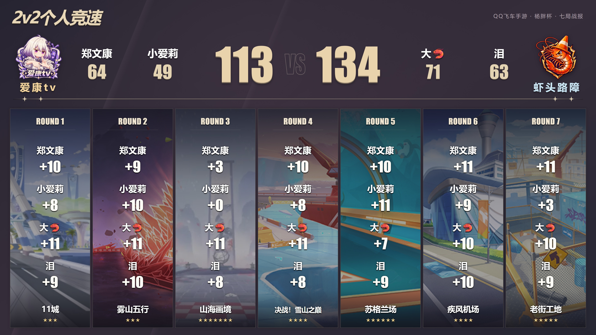
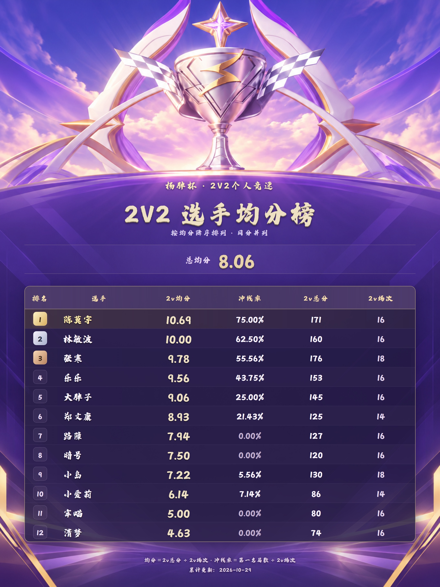

# 成图展厅

[返回首页](../README.md) · [图片原文件](../assets/README.md)

## 波喵 VS 寒岛 · 146 : 144

[高清PNG](images/report-01.png) · [JPG](images/report-01.jpg)

## 不知豆队 VS 虾头路障 · 139 : 146

[高清PNG](images/report-02.png) · [JPG](images/report-02.jpg)

## 不知豆队 VS 爱康tv · 106 : 98

[高清PNG](images/report-03.png) · [JPG](images/report-03.jpg)

## 宇宙胖猴 VS 波喵 · 113 : 94

[高清PNG](images/report-04.png) · [JPG](images/report-04.jpg)

## 寒岛 VS 宇宙胖猴 · 162 : 152

[高清PNG](images/report-05.png) · [JPG](images/report-05.jpg)

## 爱康tv VS 虾头路障 · 113 : 134

[高清PNG](images/report-06.png) · [JPG](images/report-06.jpg)

## 累计均分榜

演示成图使用指定字体，默认系统字体导出会有字形差异。
